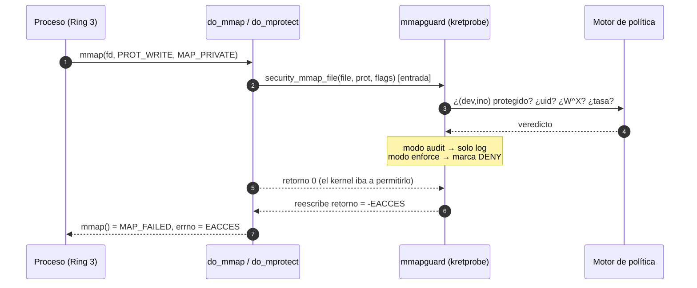

<div align="center">

# 🛡️ mmapguard

**Seguridad de archivos en la capa del kernel para `mmap()`**
*Módulo de kernel Linux que audita, restringe y detecta anomalías sobre archivos proyectados en memoria — donde el espacio de usuario ya no puede ver nada.*


Universidad EAFIT · Sistemas Operativos 2026-2 · Parcial práctico-teórico · Equipo de 3

</div>

---

## 📌 TL;DR

```bash
make                                   # compila src/mmapguard.ko
sudo make test                         # carga el módulo, corre 9 pruebas de ataque/defensa, lo descarga
sudo insmod src/mmapguard.ko protected=/etc/mi_secreto.conf mode=1
cat /proc/mmapguard                    # estado y contadores en vivo
sudo dmesg -w | grep mmapguard         # auditoría en tiempo real
```

> ⚠️ **Fedora con Secure Boot**: el kernel rechaza módulos sin firmar. Ver [§ Instalación en Fedora](#-instalación-en-fedora).

---

## 🎯 ¿Qué problema resuelve?

Con `read()`/`write()` cada acceso pasa por el kernel (Ring 0), así que cualquier defensa puede mirarlo. Con `mmap()` el kernel solo interviene **al crear el VMA y en el primer page fault**; después, la MMU atiende lecturas y escrituras **a velocidad de hardware, sin volver a Ring 0**.

```
 Proceso (Ring 3)                          Kernel (Ring 0)
 ────────────────                          ───────────────
 mmap(fd, len, prot, flags) ─────────────► valida VFS + crea vm_area_struct   ← ✅ ÚLTIMO punto de control "barato"
 *ptr = 0x41  (page fault) ──────────────► handle_mm_fault → PTE presente
 *ptr = 0x42  (acierto de TLB/PTE) ──╳     (el kernel ya no se entera)
```

Por eso la defensa **no puede vivir en espacio de usuario** (un `LD_PRELOAD` se evade con una syscall directa). `mmapguard` se ancla en los puntos de decisión de seguridad que el kernel ejecuta **en cada alta o cambio de VMA**.

---

## 🏗️ Arquitectura



| Componente | Archivo | Responsabilidad |
|---|---|---|
| Ciclo de vida y parámetros | [`src/mg_main.c`](src/mg_main.c) | `module_param`, init/exit ordenados |
| Intercepción | [`src/mg_hooks.c`](src/mg_hooks.c) | kretprobes en `security_mmap_file` y `security_file_mprotect` |
| Política | [`src/mg_policy.c`](src/mg_policy.c) | Resolución de archivos, reglas R1–R3, limitador de tasa |
| Observabilidad | [`src/mg_proc.c`](src/mg_proc.c) | `/proc/mmapguard` |
| Auditoría eBPF | [`tools/audit_mmap.bt`](tools/audit_mmap.bt) | Vista complementaria sin recompilar el kernel |

### ¿Por qué kretprobe sobre `security_*` y no otra cosa?

| Alternativa | Veredicto |
|---|---|
| **Parchear la System Call Table** | ❌ Ya no es exportada; exige limpiar `CR0.WP` (inseguro en SMP), rota con cada kernel, y no ve `mmap` hecho vía `io_uring`/`execve`. |
| **Registrar un LSM propio** | ❌ Los LSM son *built-in* (`security_add_hooks` no es exportado a módulos). Habría que recompilar el kernel. |
| **LD_PRELOAD / ptrace** | ❌ Espacio de usuario: evadible con syscalls directas. |
| **eBPF-LSM (`lsm/file_mmap`)** | ✅ Ideal, pero exige `bpf` en `lsm=` del arranque y toolchain BPF. Queda como trabajo futuro. |
| **kretprobe en `security_mmap_file` / `security_file_mprotect`** ✅ | Funciona con kernels 5.x/6.x **sin recompilar**, cubre **todas** las rutas (`mmap`, `execve`, `dlopen`, `io_uring`) porque todas pasan por ese gancho, y permite **vetar** el resultado reescribiendo el retorno. |
| **eBPF con kprobe/fexit** (`tools/audit_mmap.bt`) | ✅ Para **auditar** (los kprobes de eBPF no pueden vetar). Por eso el diseño es **híbrido**: LKM decide, eBPF observa. |

---

## 📜 Política de seguridad

Un archivo se protege por **(dispositivo, inodo)** resuelto al cargar el módulo (no por ruta: renombrar o usar un enlace duro no lo evade, y la decisión en el *hot path* es una comparación de enteros, segura en contexto atómico).

| Regla | Condición sobre archivo protegido | Acción (enforce) | Motivo |
|---|---|---|---|
| **R1 · W^X** | `PROT_WRITE` **y** `PROT_EXEC` | `-EACCES` siempre | Bloquea inyección de código en mapeos de archivo |
| **R2 · Escritura** | `PROT_WRITE` (SHARED **o** PRIVATE) con `euid != allow_uid` | `-EACCES` | Cierra el caso `O_RDONLY` + `PROT_WRITE` + `MAP_PRIVATE` y evita alteración temporal vía COW |
| **R3 · Tasa** | `> rate_max` mapeos por `rate_window_ms` por proceso | `-EACCES` | Detecta escaneos/ráfagas anómalas |
| **R4 · `mprotect`** | Cambiar un VMA de archivo protegido a `PROT_WRITE` (o W\|X) | `-EACCES` | Evita *map RO → mprotect RW* |
| **Auditoría** | Toda denegación (o intento en modo audit) | Línea en `dmesg` con `comm`, `pid`, `euid`, ruta, `prot`, tipo | Trazabilidad |

Los archivos **no protegidos** solo pagan un contador *per-CPU* y una comparación (ver [benchmarks](#-medición-de-impacto)).

---

## 🗂️ Estructura del repositorio

```
mmapguard/
├── Makefile                  # all | load | unload | test | bench | status | clean
├── README.md
├── src/
│   ├── Kbuild
│   ├── mmapguard.h           # interfaz interna
│   ├── mg_main.c             # parámetros + init/exit
│   ├── mg_hooks.c            # kretprobes (intercepción)
│   ├── mg_policy.c           # reglas y limitador
│   └── mg_proc.c             # /proc/mmapguard
├── tests/
│   ├── run_tests.sh          # orquesta carga → pruebas → descarga
│   ├── test_mmapguard.py     # 9 pruebas de ataque/defensa (ctypes + syscalls reales)
│   ├── bench.sh              # overhead (3 escenarios) + perf stat
│   └── bench_mmap.c          # microbenchmark mmap + page fault
├── tools/audit_mmap.bt       # auditoría eBPF (bpftrace)
└── scripts/
    ├── setup_fedora.sh       # dependencias + chequeo de Secure Boot
    └── sign_module.sh        # firma del .ko con MOK
```

---

## 🐧 Instalación en Fedora

### 1. Dependencias
```bash
./scripts/setup_fedora.sh
# equivale a: sudo dnf install gcc make kernel-devel-$(uname -r) kernel-headers elfutils-libelf-devel python3 perf bpftrace
```

### 2. Secure Boot (el paso que más sorprende)
```bash
mokutil --sb-state
```
- **`SecureBoot disabled`** → continúa al paso 3.
- **`SecureBoot enabled`** → elige una opción:
  - *Rápida:* desactiva Secure Boot en la BIOS/UEFI. ⚠️ Si compartes disco con **Windows + BitLocker**, puede pedirte la clave de recuperación: tenla a mano.
  - *Correcta:* `./scripts/sign_module.sh` (genera llave, la enrolas con `mokutil` al reiniciar y firma el `.ko`).

### 3. Compilar y cargar
```bash
make                                                    # debe terminar sin warnings
sudo insmod src/mmapguard.ko protected=/tmp/secreto.txt mode=1
cat /proc/mmapguard
sudo rmmod mmapguard
```

### Parámetros (modificables en caliente en `/sys/module/mmapguard/parameters/`)

| Parámetro | Defecto | Descripción |
|---|---|---|
| `protected` | — | Lista de rutas separadas por coma (máx. 16) |
| `mode` | `1` | `0` = audit (solo registra) · `1` = enforce (bloquea) |
| `allow_uid` | `0` | `euid` con permiso de mapear escribible; `-1` = nadie |
| `rate_max` | `100` | Máx. mapeos por ventana y proceso |
| `rate_window_ms` | `1000` | Tamaño de la ventana |
| `verbose` | `0` | Registrar también los mapeos permitidos |

```bash
echo 0 | sudo tee /sys/module/mmapguard/parameters/mode   # pasar a audit sin recargar
```

---

## 🧪 Pruebas

```bash
sudo make test
```

El script crea archivos de prueba, carga el módulo con `allow_uid=4242` (así **root también es "no autorizado"** y se puede atacar desde root) y ejecuta:

| # | Escenario | Resultado esperado |
|---|---|---|
| T01 | `mmap` RW sobre archivo **no** protegido | ✅ permitido (sin falsos positivos) |
| T02 | `mmap` R de archivo protegido | ✅ permitido |
| T03 | `mmap` RW `MAP_SHARED` por uid no autorizado | ⛔ `EACCES` |
| T04 | `O_RDONLY` + `PROT_WRITE` + `MAP_PRIVATE` | audit: pasa y se registra · enforce: ⛔ `EACCES` |
| T05 | `mmap` R → `mprotect(RW)` | ⛔ `EACCES` |
| T06 | W\|X con uid **autorizado** | escritura ✅ · W\|X ⛔ |
| T07 | Ráfaga de 200 `mmap` (límite 50/s) | ⛔ los excedentes · la ventana se reinicia |
| T08 | Carrera tipo Dirty COW: 4 hilos con `mprotect` + `madvise(DONTNEED)` + `/proc/self/mem` durante 3 s | SHA-256 del archivo **idéntico** |
| T09 | Contadores en `/proc/mmapguard` | coherentes |

Ejemplo de línea de auditoría:
```
mmapguard: DENY mmap reason=unauthorized-write-map comm=python3 pid=4121 euid=0 file=/tmp/mg_test/secret.txt ino=1048 prot=rw- PRIVATE
```

### Auditoría complementaria con eBPF
```bash
sudo bpftrace tools/audit_mmap.bt
```

---

## 📊 Medición de impacto

```bash
sudo make bench                 # ITER=500000 REPS=5 por defecto
```

Mide `mmap + primer acceso + munmap` en tres escenarios y ejecuta `perf stat`. Los resultados quedan en `results/`.

| Escenario | ns / iteración (mediana) | Δ vs. A | Page faults / iter |
|---|---:|---:|---:|
| **A** · sin módulo | _completar_ | — | _completar_ |
| **B** · módulo, archivo no protegido | _completar_ | _completar_ | _completar_ |
| **C** · módulo, archivo protegido | _completar_ | _completar_ | _completar_ |

Para profundizar con **ftrace** (cuánto tarda `security_mmap_file` con el kprobe activo):
```bash
sudo trace-cmd record -p function_graph -g security_mmap_file ./tests/bench_mmap /tmp/mg_bench/secret.txt 10000
trace-cmd report | head -50
```
y con `strace -c ./tests/bench_mmap ...` para confirmar que el número de syscalls no cambia.

> **Por qué el costo es bajo:** el hot path es un `this_cpu_inc`, un bucle sobre ≤16 pares `(dev, ino)` y, si el archivo **no** está protegido, el entry-handler devuelve distinto de 0 y el kretprobe **omite el handler de retorno**.

---

## ⚠️ Limitaciones (honestas)

| Vector no cubierto | Mitigación propuesta |
|---|---|
| **Root con `CAP_SYS_MODULE`** puede `rmmod mmapguard` | Firma obligatoria de módulos, `lockdown=integrity`, o mover la política a **eBPF-LSM** / LSM built-in |
| **`/proc/self/mem` + `FOLL_FORCE`** escribe páginas sin pasar por `mmap` | Es la ruta de Dirty COW (CVE-2016-5195); cubierta por el parche del kernel ≥ 4.9. `mmapguard` **no** pretende reemplazarlo (T08 lo verifica empíricamente) |
| **Acceso con `read()`/`write()`** (no mmap) | Fuera del alcance: complementar con `security_file_permission` / fanotify |
| **Archivo reemplazado por `rename()`** (nuevo inodo) | Re-resolver con `fsnotify` o proteger el directorio |
| **Pérdida de eventos** si se agotan las instancias del kretprobe (`nmissed`) → *fail-open* | Aumentar `maxactive`; se reporta al descargar el módulo |
| **No hay cifrado transparente** de páginas | Requiere `fscrypt`/`dm-crypt` + keyring; ver Pregunta 5 del informe |
| **Páginas ya mapeadas** antes de cargar el módulo | Recargar procesos o recorrer `mm_struct` (trabajo futuro) |
| **Hipervisor/hardware** | EPT/NPT, Intel MPK/PKU y CET reducen superficie incluso con kernel comprometido |

---

## 🗺️ Roadmap

- [ ] Política desde archivo (`/etc/mmapguard.conf`) con *reload* sin recompilar
- [ ] Versión **eBPF-LSM** (`lsm/file_mmap`) como alternativa sin módulo
- [ ] Hook a nivel de page fault (`handle_mm_fault`) vía `fentry` para auditar *dirtying*
- [ ] Evento por `netlink`/ring buffer en lugar de `dmesg`

---

## ✅ Estado de validación

| Verificación | Estado |
|---|---|
| Compila **sin warnings** contra headers Linux **6.8** | ✅ |
| Compila **sin warnings** contra headers Linux **6.17** | ✅ |
| `make` en tu Fedora (kernel `uname -r` = ______ ) | ⬜ |
| `sudo make test` → 9/9 | ⬜ |
| `sudo make bench` + tabla completada | ⬜ |
| `bpftrace tools/audit_mmap.bt` ejecutado | ⬜ |

---

## 🤖 Uso de IA en el proyecto

El flujo asistido por IA (exploración de estructuras del kernel, generación y verificación del C, tabla de prompts y **alucinaciones detectadas**) está documentado en el informe de sustentación (Parte II del parcial).

---

## 👥 Equipo

| Integrante | GitHub |
|---|---|
| **Matías Zapata Rojas** | [@matias910](https://github.com/matias910) |
| **Samuel Valencia Montoya** | [@samuval94](https://github.com/samuval94) |
| **Valentina Barbosa** | — |

Ingeniería de Sistemas · Universidad EAFIT · Sistemas Operativos 2026-2

Licencia: **GPL-2.0** (requerida por los símbolos `EXPORT_SYMBOL_GPL` de kprobes).
